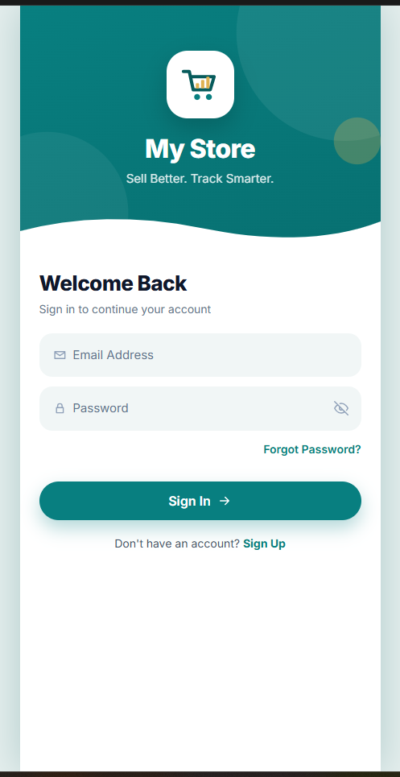
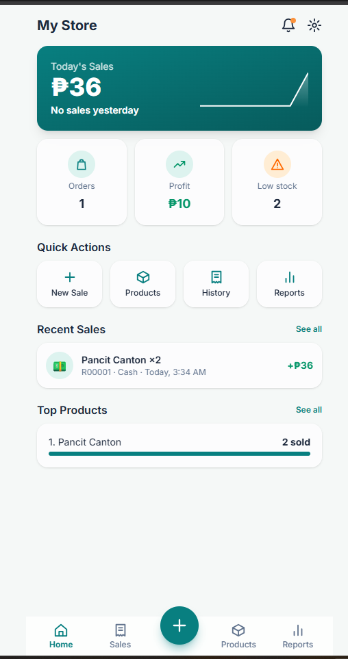
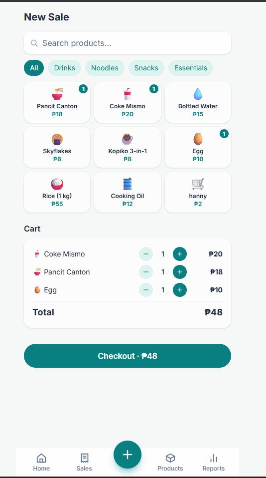
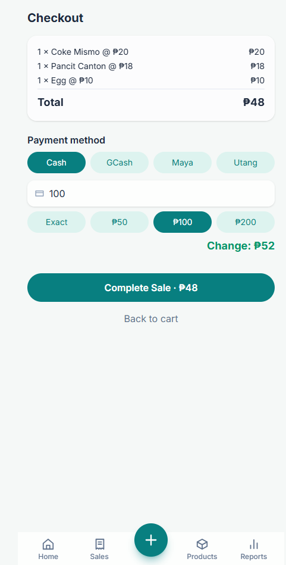
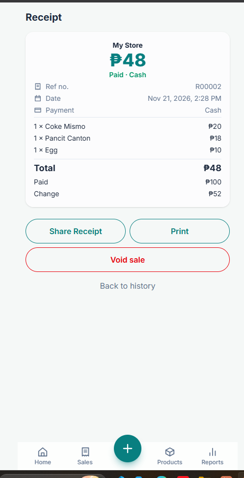
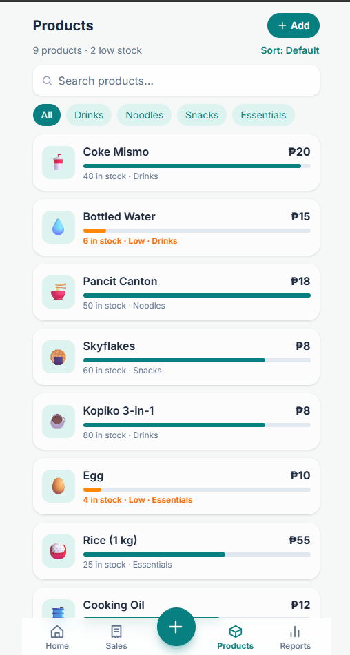
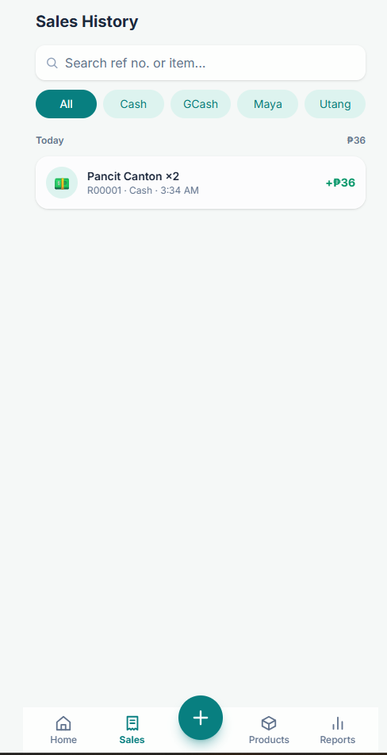
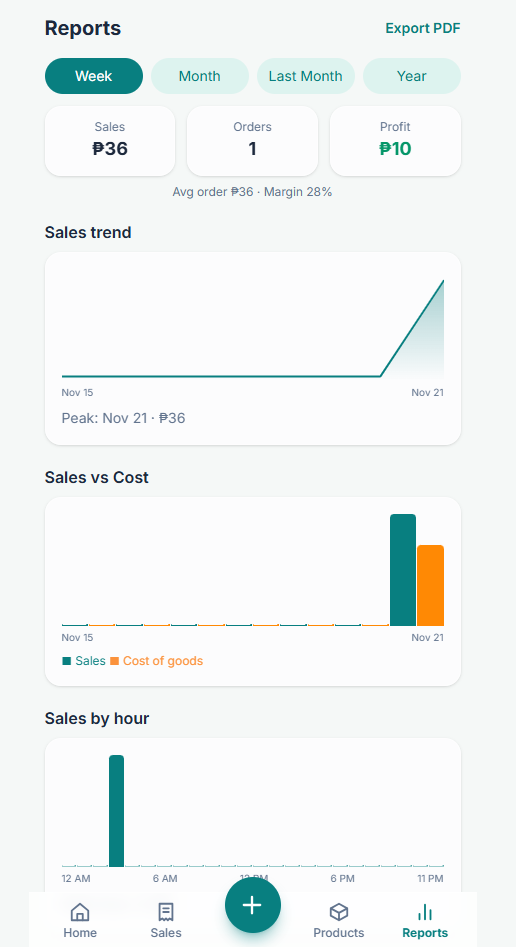

# POS & Sales Analytics

A mobile-first point-of-sale web app that helps small store owners record sales, compute change, manage stock, and understand their business through analytics.

> UI inspired by the BuildFlow concept design. The code and the POS app are my own work.

## The Problem
Small store owners often track sales and stock by hand, so it's hard to know what sells best, when customers come, and what's running low.

## The Solution
A fast, simple POS for checkout, plus a dashboard that turns sales records into clear insights.

## Features
- Fast checkout: cart, quick-cash buttons, automatic change
- Cash, GCash, Maya, and Utang (credit) payment recording
- Product and stock management with low-stock alerts
- Sales history with filters, search, digital receipts (share / print), and void sale
- Analytics: best-sellers, peak hours, sales by category, profit estimate
- Best-sellers shown first; long-press a product to set quantity
- Settings: store name, light/dark/auto theme, currency, backup and restore (JSON)
- Works offline in the browser: data is stored in localStorage

## Screenshots
| Login | Home | New Sale |
|---|---|---|
|  |  |  |

| Checkout | Receipt | Products |
|---|---|---|
|  |  |  |

| Sales History | Reports |
|---|---|
|  |  |

## Tech Stack
- React 19 (JavaScript)
- Tailwind CSS
- Inter font
- localStorage for data (data code is separate from the screens, so a backend can replace it later)

## Project Structure
```
index.html   page shell
styles.css   Tailwind CSS
app.js       app code (screens, data, routing)
vendor.js    React runtime
```

## Run Locally
Open `index.html` in a browser. No build step needed.

## Deploy
Static site: upload the folder to GitHub, then import the repo in Vercel (no build command, output is the root folder).

## Roadmap
Backend and login (Supabase/Firebase), owner and cashier accounts, PayMongo test mode, offline PWA, export to CSV/PDF.
